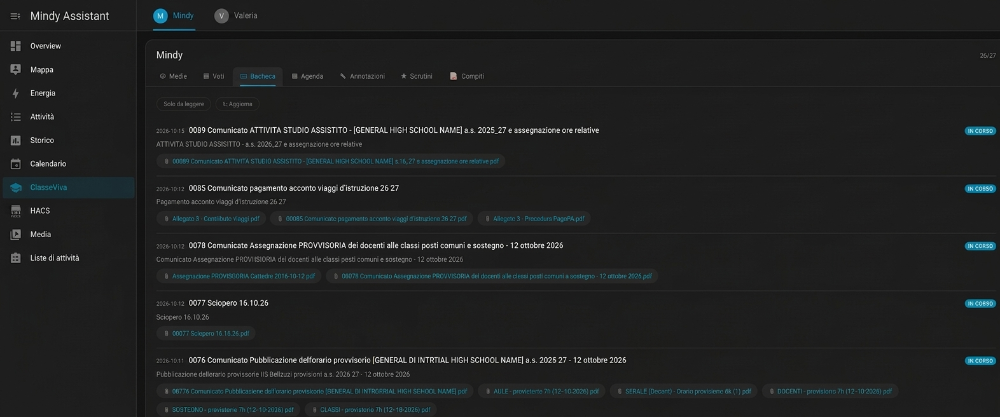
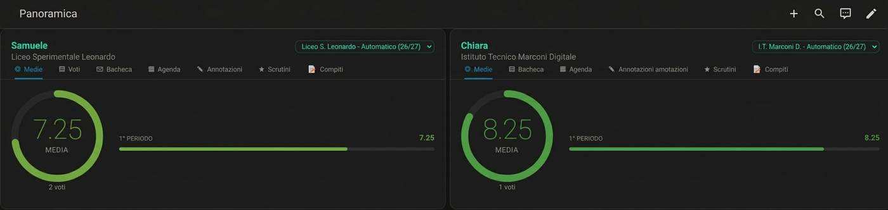
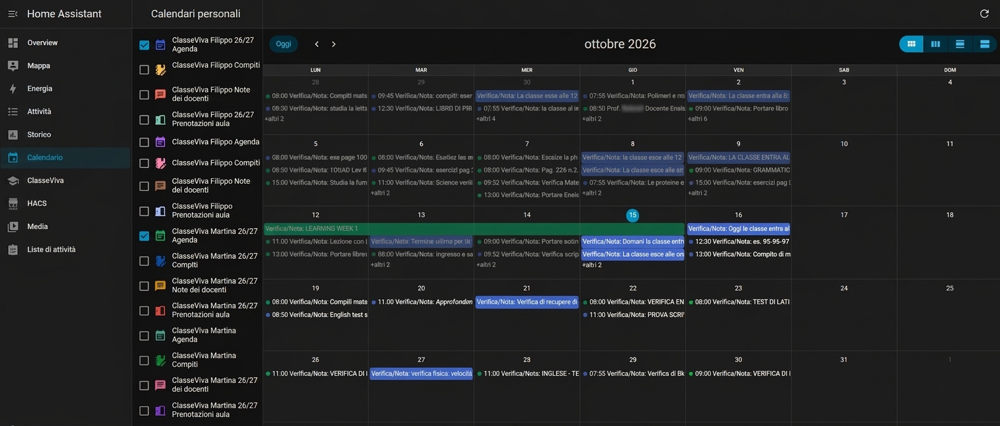

<p align="center">
  
</p>

# CVV Dashboard

[](https://github.com/hacs/integration)
[](https://github.com/Sythos/Classeviva-Dashboard/releases)
[](LICENSE)

[](https://my.home-assistant.io/redirect/hacs_repository/?owner=Sythos&repository=Classeviva-Dashboard&category=integration)

Integrazione per **Home Assistant** che porta il registro elettronico **ClasseViva**
(Gruppo Spaggiari) in una dashboard completa: medie, voti, bacheca, agenda, annotazioni,
scrutini e compiti, più i calendari integrati in Home Assistant.

> Progetto indipendente, non affiliato né supportato da Gruppo Spaggiari.
> Accede solo ai dati del proprio account, come farebbe l'app ufficiale.

## Cos'è la Dashboard

CVV Dashboard raccoglie in un'unica **card Lovelace** tutto ciò che il registro mostra su
più pagine. La card trova da sola le entità dell'integrazione: non serve indicare nessun
`entity_id`.

| Scheda | Contenuto |
|---|---|
| **Medie** | Media generale in un grafico con quadrimestri |
| **Voti** | Cerchio con la media generale, barra per materia, ultimi voti; clic sulla materia per il dettaglio |
| **Bacheca** | Comunicazioni con testo e allegati, filtro "solo da leggere"; il testo HTML è mostrato formattato (link in una nuova scheda, senza script) |
| **Agenda** | Eventi e annotazioni raggruppati per giorno |
| **Annotazioni** | Annotazioni dei docenti e note disciplinari |
| **Scrutini** | Pagelle e pagellini pubblicati, scaricabili |
| **Compiti** | Compiti assegnati, raggruppati per giorno |

Il colore va in modo continuo dal rosso al verde in base al voto, con animazioni di
ingresso e un layout che si adatta alla larghezza della card. Sotto i 460 px le schede
mostrano le sole icone.

## Requisiti

> **HACS deve essere già installato** in Home Assistant. Questa integrazione si installa
> solo tramite HACS: senza HACS segui la procedura manuale più sotto.

- Home Assistant 2024.7.0 o successivo.
- [HACS](https://hacs.xyz) installato e configurato.
- Un account ClasseViva (genitore o studente).

## Installazione

### HACS

Clicca il pulsante per aprire il repository nel tuo HACS:

[](https://my.home-assistant.io/redirect/hacs_repository/?owner=Sythos&repository=Classeviva-Dashboard&category=integration)

Oppure, a mano:

1. HACS → menu ⋮ → *Repository personalizzati*.
2. Incolla l'URL di questo repository, categoria **Integration**.
3. Cerca **CVV Dashboard**, installa e riavvia Home Assistant.
4. *Impostazioni → Dispositivi e servizi → Aggiungi integrazione → CVV Dashboard*.

La card Lovelace è inclusa nell'integrazione e viene caricata da sola: non serve
registrare nessuna risorsa.

### Manuale

Copia `custom_components/cvv_dashboard/` in `<config>/custom_components/`, riavvia
Home Assistant e aggiungi l'integrazione come al punto 4.

## Configurazione

| Campo | Descrizione |
|---|---|
| Username | email o codice utente del registro |
| Password | password del registro (salvata solo in Home Assistant) |
| Seleziona Anno | `Ultimo` per l'anno più recente con dati, oppure un anno preciso |

L'anno accetta i formati `25/26`, `2025/2026` o `25`, sempre interpretato come anno di
**inizio**. L'anno scolastico va dal 1° settembre al 31 agosto.

Per guardare gli anni passati nella card **non serve** aggiungere l'account più volte: vedi
[Cambiare anno scolastico](#cambiare-anno-scolastico). Aggiungere lo stesso account su un
anno preciso resta utile solo se vuoi sensori e calendari separati per quell'anno (ogni
istanza crea un dispositivo distinto).

### Cambiare password o anno

- **Password cambiata sul registro:** quando il registro rifiuta la password salvata, Home Assistant
  mostra una notifica *Riautenticazione*. Inserisci la password nuova: l'integrazione la prova,
  verifica che l'account sia lo stesso studente e la salva, senza ricreare niente.
- **Cambiare password o anno di un'istanza esistente:** *Impostazioni → Dispositivi e servizi →
  CVV Dashboard → Configura*. Lascia la password vuota per tenere quella attuale. Cambiando anno,
  entità e dispositivo mantengono gli stessi id, quindi dashboard e automazioni continuano a funzionare.
- La password viene provata sul registro prima di essere salvata. L'integrazione rifiuta un account
  di un altro studente e un anno già usato da un'altra istanza.

## Configurabilità della card

```yaml
type: custom:cvv-dashboard-card
```

Opzioni comuni:

| Opzione | Valori | Default |
|---|---|---|
| `vista` | `medie`, `voti`, `bacheca`, `agenda`, `note`, `scrutini`, `compiti`, `combo` | `combo` |
| `account` | parte dell'entity_id, se hai più studenti | — |
| `anno_scolastico` | anno configurato, ad esempio `"26/27"` | più recente |
| `titolo` | testo dell'intestazione (`""` per nasconderla) | nome dello studente |
| `animazioni` | `true` / `false` | `true` |
| `selettore_anno` | `true` / `false`: mostra il menu per cambiare anno | `true` |
| `versione` | `true` mostra la versione della card in fondo | `false` |

### Cambiare anno scolastico

In alto a destra la card mostra un **menu a tendina con l'anno scolastico**, quando ce n'è
più di uno:

- **Automatico** segue l'anno in corso. Il nuovo anno parte il **1° settembre**: fino al
  31 agosto vale l'anno iniziato a settembre precedente. Se quell'anno non è disponibile
  si usa il più recente.
- Gli anni offerti sono quelli delle istanze configurate più quelli che il registro elenca
  per lo studente. Se il registro ne elenca uno solo, il menu propone l'anno in corso e
  quello appena concluso.
- La scelta resta nel browser. Nella pagina del menu laterale vale per tutti gli studenti.
- Un anno che non ha un'istanza viene scaricato **al momento**, riusando il login già
  attivo, e tenuto in cache per 30 minuti: non servono altri accessi al registro. Il
  primo caricamento di un anno passato può richiedere qualche secondo.
- `anno_scolastico` nella configurazione resta l'anno di partenza. Con
  `selettore_anno: false` il menu sparisce e vale solo `anno_scolastico`.

```yaml
type: custom:cvv-dashboard-card
account: anna
anno_scolastico: "25/26"   # anno di partenza, poi si cambia dal menu
```

Solo per `vista: medie`:

| Opzione | Valori | Default |
|---|---|---|
| `layout` | `auto`, `verticale`, `orizzontale` | `auto` |
| `dimensione` | diametro del cerchio in px | `170` |
| `periodi` | `true` / `false`, linee dei quadrimestri | `true` |
| `massimo` | voto massimo della scala | `10` |

Esempi:

```yaml
type: custom:cvv-dashboard-card
vista: medie
layout: verticale
dimensione: 190
```

```yaml
type: custom:cvv-dashboard-card
vista: compiti
account: anna
anno_scolastico: "26/27"
```

L'editor visuale della card propone gli anni disponibili tra le istanze configurate.

### Voce nel menu laterale

**Modo semplice:** *Impostazioni → Dispositivi e servizi → CVV Dashboard → Configura* e attiva
**Mostra nel menu laterale**. La voce *CVV Dashboard* compare subito, senza riavviare e senza
toccare `configuration.yaml`. Basta attivarla su una sola istanza: vale per tutti gli studenti,
e si toglie disattivando l'opzione. Se hai già una pagina con indirizzo `cvv-dashboard` messa a
mano (vedi sotto), l'integrazione non la tocca e non crea la voce automatica: scegli una delle due.

**A mano**, per personalizzare titolo, icona o le opzioni della pagina, aggiungi a
`configuration.yaml`:

```yaml
panel_custom:
  - name: cvv-dashboard-card-panel
    url_path: cvv-dashboard
    sidebar_title: CVV Dashboard
    sidebar_icon: mdi:school
    module_url: /cvv_dashboard_static/cvv-dashboard-card.js?v=0.4.2
    config:
      vista: combo
      anno_scolastico: "26/27"
      dimensione: 200
```

In cima alla pagina c'è un pulsante per ogni studente configurato; la scelta è ricordata
dal browser. Con `studenti` si decide quali account mostrare e in che ordine; ogni voce
è un account oppure una coppia `account` e `nome` per cambiare il nome mostrato:

```yaml
studenti:
  - anna
  - account: luca
    nome: Lu
```

Senza `studenti` compaiono tutti, in ordine alfabetico. Dopo un aggiornamento cambia il
numero dopo `?v=` e riavvia, altrimenti il browser può usare la versione in cache.

## Uso in Panorama (Lovelace)

Con **Lovelace** la card si può mettere in una vista di tipo **Panorama** (una sola card a
tutta larghezza, `type: panel` in YAML). Per mostrare due studenti affiancati usa uno
stack orizzontale:

```yaml
views:
  - title: Panoramica
    type: panel
    cards:
      - type: horizontal-stack
        cards:
          - type: custom:cvv-dashboard-card
            account: luca
            vista: agenda
          - type: custom:cvv-dashboard-card
            account: giulia
            vista: voti
```

Per allargare la card in una vista a **sezioni** usa:

```yaml
type: custom:cvv-dashboard-card
grid_options:
  columns: 12
```

## Integrazione con il calendario di Home Assistant

L'integrazione crea **quattro calendari per studente**, così nel calendario di Home
Assistant ognuno ha il suo colore:

- **Agenda**: riepilogo di compiti e annotazioni
- **Compiti**: solo i compiti assegnati
- **Note dei docenti**: annotazioni, avvisi, aule virtuali
- **Prenotazioni aula**: solo le prenotazioni d'aula

Si attivano dalle caselle a sinistra nella pagina *Calendario* e si possono usare in
qualunque card `calendar`:

```yaml
type: calendar
initial_view: dayGridMonth
entities:
  - entity: calendar.cvv_dashboard_nome_compiti
    color: "#D7D765"
  - entity: calendar.cvv_dashboard_nome_note_dei_docenti
    color: "#A5D7FD"
  - entity: calendar.cvv_dashboard_nome_prenotazioni_aula
    color: "#55f74f"
```

Controlla i nomi esatti delle entità in *Strumenti per sviluppatori → Stati*.

## Sensori e servizi

| Entità | Stato | Attributi principali |
|---|---|---|
| Media | media generale | `per_materia`, `per_periodo`, `anno` |
| Voti | numero di voti | `items`, `insufficienze` |
| Agenda | eventi in agenda | `items` (compiti e annotazioni) |
| Bacheca | comunicazioni non lette | `items` con testo e allegati; `omesse` |
| Note | note e annotazioni | `items`, `da_leggere` |
| Scrutini | documenti pubblicati | `items` con `download_url` |
| File Docenti | file condivisi | `items` per docente |

| Servizio | Cosa fa |
|---|---|
| `cvv_dashboard.aggiorna` | forza subito il download dei dati |
| `cvv_dashboard.carica_testi_bacheca` | scarica i testi mancanti **senza** segnarli come letti |
| `cvv_dashboard.leggi_comunicazione` | apre una comunicazione e ne restituisce il testo (**la segna come letta**) |

Gli allegati si scaricano da `/api/cvv_dashboard/download` con URL firmate valide 12 ore.
Aprire una pagella da qui **non** registra la presa visione.

## Screenshot

### Pagina a schermo intero nel menu laterale



La voce di menu apre la dashboard a schermo intero. In alto la barra degli studenti
(Mindy e Valeria); sotto le schede Medie, Voti, Bacheca, Agenda, Annotazioni, Scrutini e
Compiti. Nell'esempio è aperta la **Bacheca**: comunicazioni con data, stato "in corso",
allegati scaricabili e i pulsanti *Solo da leggere* e *Aggiorna*.

### Vista Panorama con due studenti



Due card affiancate in una vista Panorama, una per studente, ognuna con le proprie
schede. A sinistra l'**Agenda** di uno studente con gli eventi raggruppati per giorno; a
destra i **Voti** di un altro, con il cerchio della media generale, la barra per materia
e gli ultimi voti colorati in base al valore.

### Calendario di Home Assistant



La pagina *Calendario* di Home Assistant con i calendari di ClasseViva. Per ogni studente
ci sono Agenda, Compiti, Note dei docenti e Prenotazioni aula, attivabili con le caselle
a sinistra; verifiche, note e compiti compaiono nella vista mensile, ognuno nel colore
del proprio calendario.

## Note

- I dati si aggiornano ogni 30 minuti.
- La chiave API in `const.py` è quella dell'app Android ufficiale. Spaggiari la cambia
  periodicamente: se il login dà errore `apikey.3` va ricatturata da una versione recente
  dell'app.
- Troppi tentativi di login sbagliati bloccano l'account per circa 60 minuti.
- Alcune azioni registrano la lettura sul registro. L'integrazione le compie solo se le
  chiedi, con il servizio `leggi_comunicazione`.
- Gli screenshot e la documentazione non fanno parte della release HACS: l'archivio
  installato contiene solo `custom_components/cvv_dashboard`.

## Licenza

[MIT](LICENSE)

## Crediti

Per l'accesso al registro è stato usato il codice API di
[Davitekk](https://github.com/Davitekk), autore dell'idea originale di integrazione e
card per ClasseViva su Home Assistant, rilasciato con licenza MIT.
