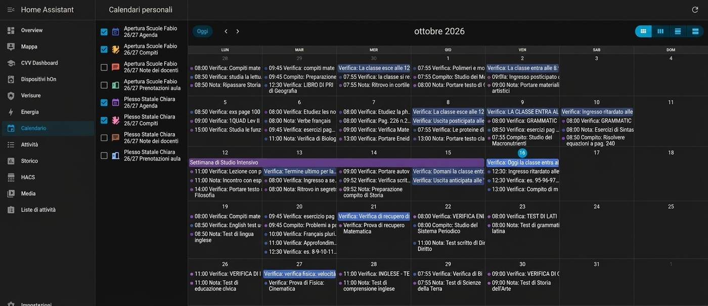

# Calendars, sensors, and services

CVV Dashboard adds sensors and four calendars for each configured student.

## Calendars

| Calendar | Contents |
|---|---|
| Agenda | Homework and notes, except room bookings. |
| Compiti | Assigned homework. |
| Note dei docenti | Teacher notes, notices, and virtual classroom events. |
| Prenotazioni aula | Room bookings. |

Enable calendars in **Calendar** in Home Assistant. You can also use their entity IDs in a Lovelace Calendar card. Find the exact IDs in **Developer tools > States**.

<figure markdown>
  
  <figcaption>Example 1. Home Assistant Calendar can show events from the CVV Dashboard calendars that you enable.</figcaption>
</figure>

## Sensors

| Sensor | Data |
|---|---|
| Media | General average, subject averages, term averages, and year. |
| Voti | Mark count, marks, and the number of insufficient marks. |
| Agenda | Events, homework, and notes. |
| Bacheca | Unread notices, notice text, attachments, and skipped items. |
| Note | Teacher comments and disciplinary notes. |
| Scrutini | Published report cards and download links. |
| File Docenti | Files that teachers shared. |

Attributes can include personal school data. Do not post them in a public issue.

## Services

| Service | Action |
|---|---|
| `cvv_dashboard.aggiorna` | Request a data refresh now. |
| `cvv_dashboard.carica_testi_bacheca` | Load missing notice text. It does not mark notices as read. |
| `cvv_dashboard.leggi_comunicazione` | Load a full notice and mark it as read on the ClasseViva register. |

For more than one configured student or year, choose the correct account when the service asks for one.

## Attachments and report cards

CVV Dashboard provides signed download links for notice attachments. A link stays valid for 12 hours. Opening a report card from the card does not record that you viewed it.

Opening a notice with **Leggi tutto** marks it as read. Use **Carica testi** if you want to load missing text without changing its read state.
