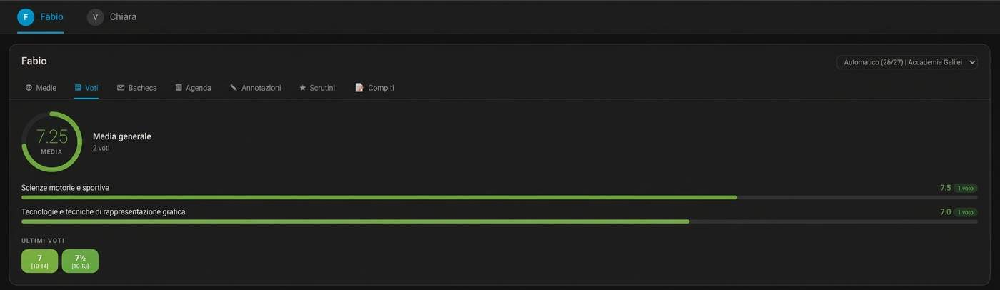
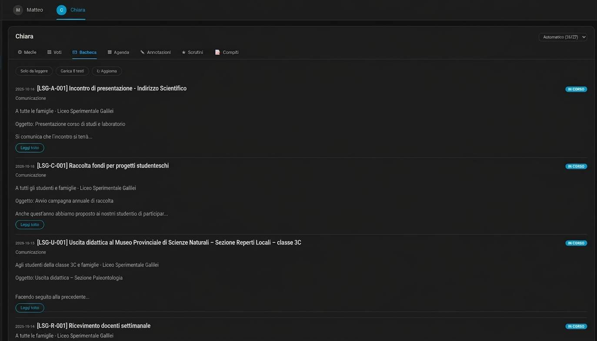

# Viste e simboli

CVV Dashboard usa etichette in italiano, come nella card. I simboli restano accanto alle etichette. Sotto 460 pixel la card mostra solo i simboli.

## Viste della card

| Simbolo | Etichetta | Dati |
|---|---|---|
| ◎ | Medie | Media generale e risultati dei periodi. |
| ▤ | Voti | Media generale, risultati per materia e voti recenti. Seleziona una materia per vedere i suoi voti. |
| ✉ | Bacheca | Comunicazioni scolastiche, testo e allegati. Usa il filtro per mostrare le comunicazioni non lette. |
| ▦ | Agenda | Eventi e note per data. Gli eventi partono da oggi e sono in ordine crescente di data e ora. |
| ✎ | Annotazioni | Annotazioni dei docenti e note disciplinari. |
| ★ | Scrutini | Pagelle e pagellini pubblicati. Puoi scaricarli dalla card. |
| 📝 | Compiti | Compiti assegnati, per data. |

## Esempi

La vista Voti mostra la media generale, i risultati per materia e i voti recenti.

<figure markdown>
  
  <figcaption>Esempio 1. La vista Voti mostra la media generale, i risultati per materia e i voti recenti.</figcaption>
</figure>

La vista Bacheca mostra le comunicazioni scolastiche. Usa **Solo da leggere** per filtrare le comunicazioni non lette. Usa **Carica testi** per caricare i testi senza cambiarne lo stato di lettura.

<figure markdown>
  
  <figcaption>Esempio 2. La vista Bacheca mostra le comunicazioni scolastiche e i comandi per filtrare o caricare i testi.</figcaption>
</figure>

Il valore `vista` `combo` mostra tutte le viste disponibili. Il valore `note` apre **Annotazioni**. Questa vista ha due sottoviste:

- **Annotazioni**: commenti dei docenti.
- **Note disciplinari**: note disciplinari.

## Comandi

| Etichetta | Funzione |
|---|---|
| **Solo da leggere** | Mostra le comunicazioni non lette nella Bacheca. |
| **Carica testi** | Carica i testi mancanti delle comunicazioni. Non le segna come lette. |
| **Aggiorna** | Richiede l'aggiornamento dei dati. |
| **Automatico** | Segue l'anno scolastico in corso. |
| **Mostra nel menu laterale** | Aggiunge il pannello CVV Dashboard al menu laterale di Home Assistant. |

Il selettore dell'anno compare quando è disponibile più di un anno. La scelta resta nel browser. Nel pannello studenti, vale per tutti gli studenti.

## Avviso di aggiornamento HACS

In una versione che supporta questa funzione, un **!** giallo può comparire prima del nome dello studente sulla card o nel pannello. Significa che HACS segnala un aggiornamento di CVV Dashboard.

Seleziona il simbolo per aprire CVV Dashboard in HACS. Installa l'aggiornamento da lì. Il simbolo compare solo se HACS è installato, se HACS segnala un aggiornamento e se l'utente Home Assistant ha i diritti di amministratore. Le release precedenti potrebbero non avere questa funzione.

## Opzioni della card

| Opzione | Valori | Predefinito |
|---|---|---|
| `vista` | `medie`, `voti`, `bacheca`, `agenda`, `note`, `scrutini`, `compiti`, `combo` | `combo` |
| `account` | Parte dell'account nell'ID dell'entità | Account rilevato |
| `anno_scolastico` | Un anno, per esempio `25/26` | Ultimo anno |
| `titolo` | Testo dell'intestazione; un valore vuoto la nasconde | Nome dello studente |
| `animazioni` | `true` o `false` | `true` |
| `selettore_anno` | `true` o `false` | `true` |
| `versione` | `true` o `false`; mostra la versione della card | `false` |

Opzioni per `vista: medie`:

| Opzione | Valori | Predefinito |
|---|---|---|
| `layout` | `auto`, `verticale`, `orizzontale` | `auto` |
| `dimensione` | Dimensione del cerchio in pixel | `170` |
| `periodi` | `true` o `false`; mostra le linee dei periodi | `true` |
| `massimo` | Voto massimo | `10` |

Esempio:

~~~yaml
type: custom:cvv-dashboard-card
vista: medie
layout: verticale
dimensione: 190
periodi: true
massimo: 10
~~~

## Voti e comunicazioni

I voti usano una scala di colore dal rosso al verde. Il testo della Bacheca è formattato per la visualizzazione. I link si aprono in una nuova scheda del browser. La card non esegue script contenuti in una comunicazione.

Aprire una comunicazione con **Leggi tutto** la segna come letta nel registro ClasseViva. Aprire una pagella da questa card non registra la presa visione.
