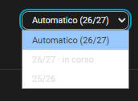

# Scegli l'anno scolastico

L'anno scolastico inizia il 1° settembre e termina il 31 agosto.

## Anno automatico

**Automatico** segue l'anno scolastico che comprende la data di oggi. Se quell'anno non ha dati, la card usa l'ultimo anno fornito da ClasseViva.

## Seleziona un altro anno

Il menu dell'anno compare quando la card può usare più di un anno. Seleziona un anno disponibile, per esempio `25/26`. La scelta resta nel browser.

<figure markdown>
  
  <figcaption>Esempio 1. Seleziona Automatico per seguire l'anno scolastico in corso oppure scegli un anno disponibile.</figcaption>
</figure>

Quando selezioni un altro anno, la card può caricarne i dati. Usa il login già attivo e mantiene i dati in cache per 30 minuti. Il primo caricamento di un anno passato può richiedere alcuni secondi.

Puoi usare uno di questi formati nella configurazione:

- `25/26`
- `2025/2026`
- `25` per un anno scolastico che inizia nel 2025

## Imposta un anno fisso su una card

Imposta `anno_scolastico` sull'anno che la card deve usare. Imposta `selettore_anno` su `false` per nascondere il menu dell'anno:

~~~yaml
type: custom:cvv-dashboard-card
account: student_one
anno_scolastico: "25/26"
selettore_anno: false
~~~

Lascia il selettore attivo se vuoi cambiare anno dalla card.

## Più studenti

Nel pannello a tutto schermo, la scelta dell'anno vale per tutti gli studenti in quel browser. Aggiungi una voce di integrazione separata per un account e un anno solo se vuoi sensori e calendari distinti.
